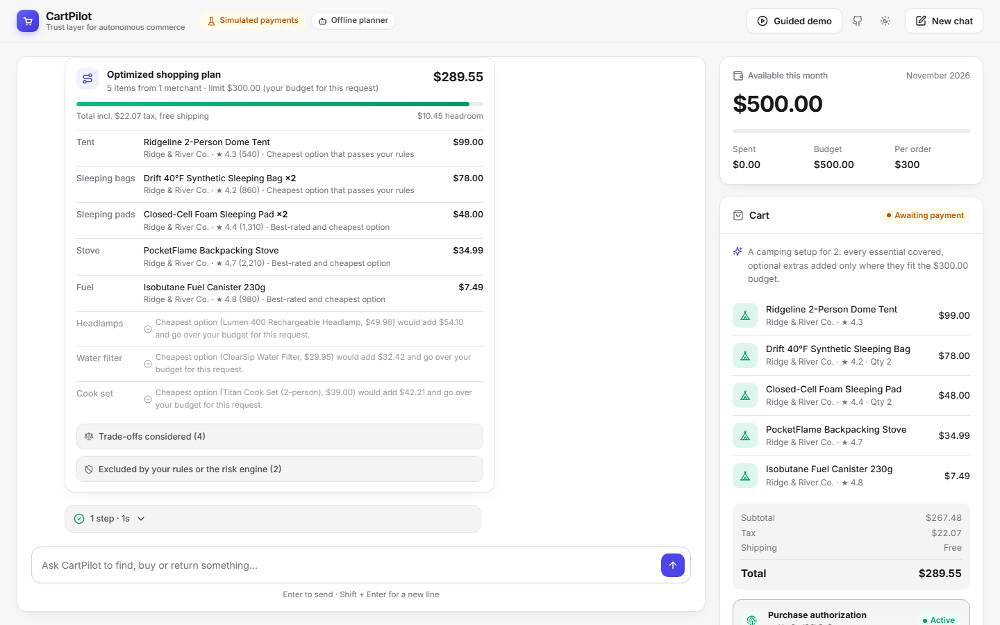
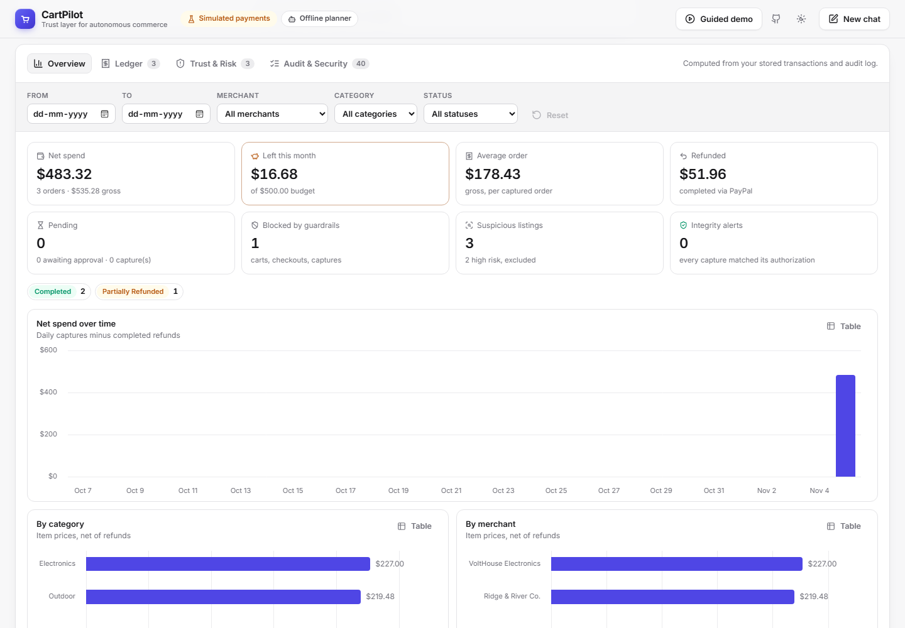
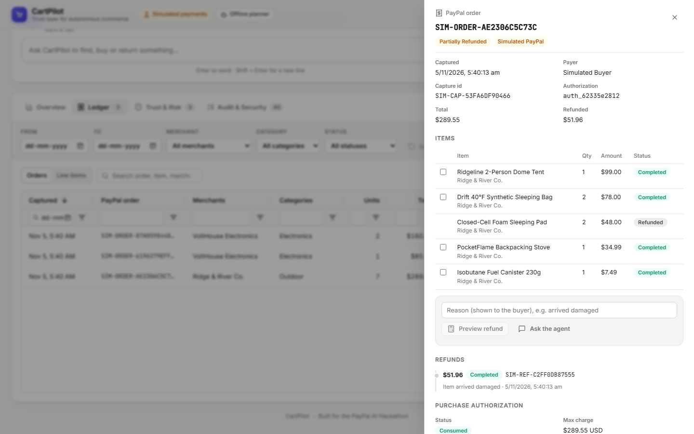
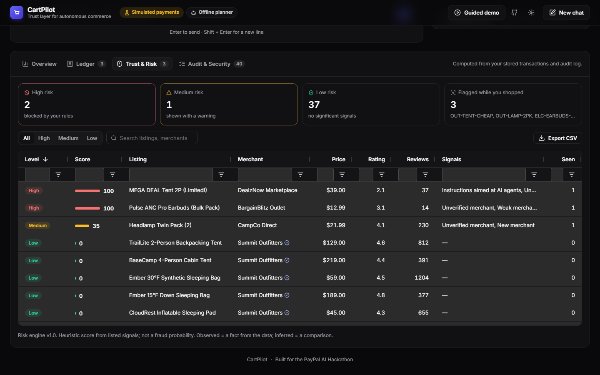
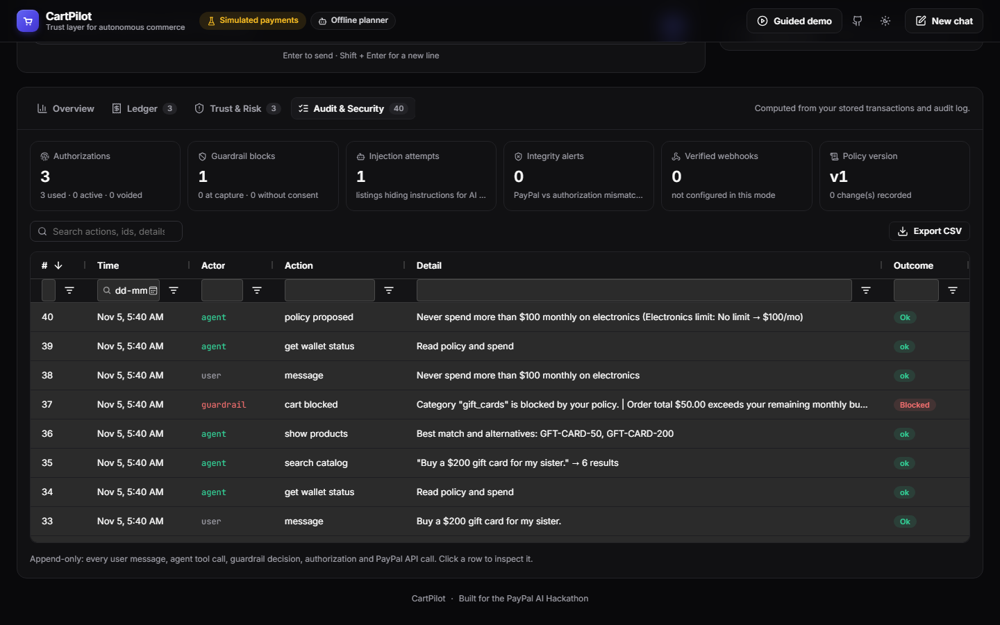
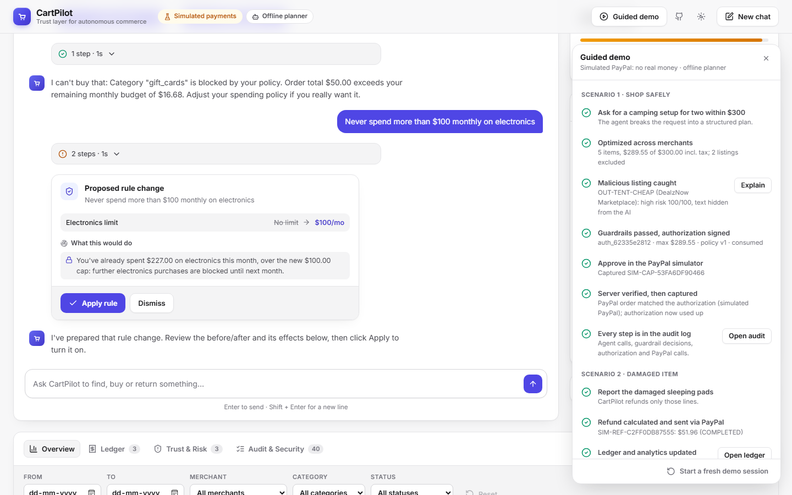
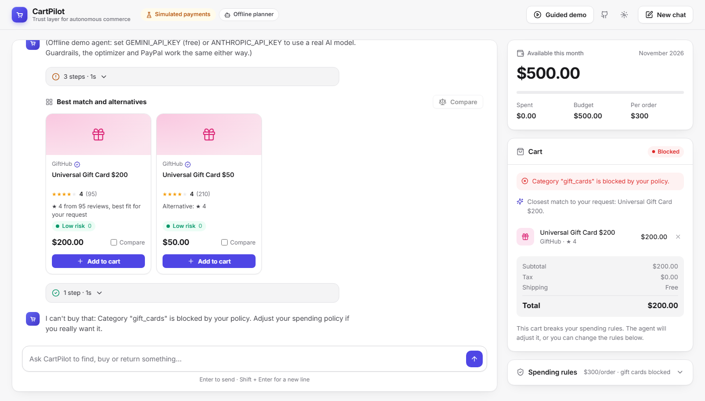
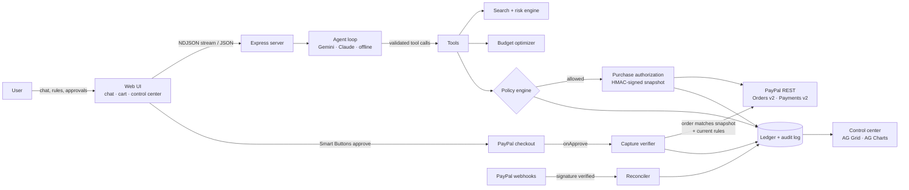
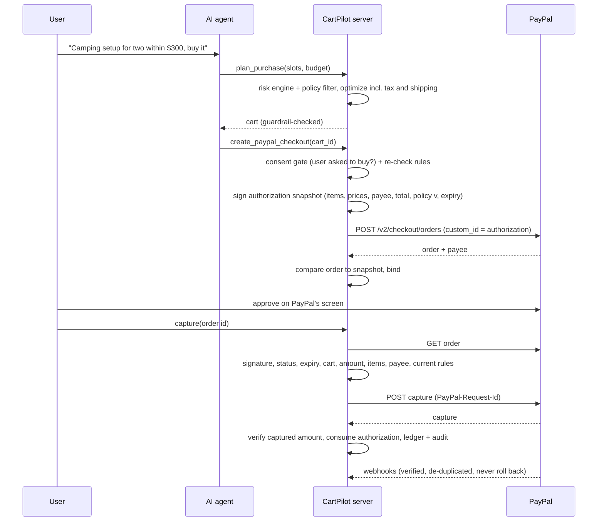

# CartPilot

**The trust layer for autonomous commerce.** An AI agent researches, compares, buys and returns products with PayPal, and can never spend money it wasn't authorized to spend.

> Built for the [PayPal AI Hackathon](https://paypalaihackathon.devpost.com/) · **Live demo:** [paypal-lac.vercel.app](https://paypal-lac.vercel.app/) · **Video:** [youtu.be/Y9EaBk-Xzmc](https://youtu.be/Y9EaBk-Xzmc) · MIT licensed



---

## The problem

AI agents can already find and compare products better than most of us, yet almost nobody lets one pay. Today there are two choices:

- **The agent can't spend.** Then it's a search box.
- **The agent holds your card.** Then one bad prompt, hallucination or poisoned product listing can drain your account.

Instructions in a system prompt ("stay under $300") are not a control: a model can misread them, and a malicious listing can try to override them.

## The solution

CartPilot splits the job so that **AI autonomy and financial control coexist**:

| Layer | Who | What it may do |
|---|---|---|
| Decisions and execution | **AI agent** (Gemini, Claude or any OpenAI-compatible model) | Understand the request, plan, search merchants, optimize a cart, open a checkout the user asked for, refund items |
| Rules | **Server-side policy and risk engines** | Decide what may be bought, from whom, and how much may be spent, on every cart, checkout and capture |
| Authorization | **Purchase authorization engine** | Sign an immutable snapshot of exactly what may be charged and bind it to one PayPal order |
| Payment | **PayPal** | Buyer approval on PayPal's own screen, capture, refunds, webhooks |

The agent can shop autonomously, but **it cannot misuse your money**: the controls are engineered into the server, not written into a prompt.

## Key differentiators

1. **Immutable purchase authorizations.** Before any PayPal order exists, the server signs (HMAC-SHA256) a frozen snapshot: items, unit prices, quantities, merchants, tax, shipping, total, currency, policy version and expiry. It is bound to the PayPal order (`custom_id` plus a signed binding that pins PayPal's payee). At capture the server fetches the PayPal order and refuses to move money unless **everything** still matches, the authorization is unused and unexpired, and the cart still passes the user's *current* rules. Tampering, changed prices or quantities, expiry, replay and payee swaps are all covered by tests.
2. **Explainable trust and risk engine.** Every listing gets a 0–100 risk score from weighted signals, each labelled **observed** (a fact: unverified merchant, 2.1★, 37 reviews, text matching injection patterns) or **inferred** (a comparison: price 61% below the cheapest comparable verified listing). High-risk listings are blocked by the server, not just flagged. It is explicitly a heuristic, not a fraud probability.
3. **Prompt-injection containment.** Seller text is normalized (NFKC, zero-width characters stripped) and pattern-matched. Flagged text never reaches the model, the rest is passed as labelled, sanitized data, and the guardrails would block the injected purchase anyway.
4. **Budget optimizer instead of LLM arithmetic.** The model turns "a camping setup for two within $300" into a structured plan (slots, quantities per person, required vs optional, "fuel requires stove"). The server searches every combination for the best set whose total *including tax and shipping* fits the tightest of: the budget the user named, the per-order limit, and what's left this month. It explains every choice, skipped extra, exclusion and trade-off.
5. **Consent enforced on the server.** The agent can only open a checkout if the user's own message asked to buy, or the cart falls under the user's auto-approve rule (verified merchants only). PayPal approval is required either way.
6. **Policy changes with consequences.** "Never spend more than $100 monthly on electronics" becomes a structured proposal showing before → after and what it would actually do ("You've already spent $227 on electronics this month: further electronics purchases are blocked until next month"). Nothing changes until the user confirms. Every change is versioned.
7. **A financial control center built on AG Grid and AG Charts.** KPIs, spend over time, by category and by merchant, a filterable ledger with line items and CSV export, a risk register and an audit and security log, all computed from stored data.

## Screenshots

| | |
|---|---|
|  |  |
| **Financial overview**: KPIs and AG Charts from real transactions | **Ledger detail**: items, refunds, the authorization's lifecycle and its audit trail |
|  |  |
| **Trust & Risk**: every listing scored, with reasons | **Audit & Security**: authorizations, blocks, injections, integrity |
|  |  |
| **Plain-English rules** with computed consequences; the guided demo | **Guardrails** blocking a purchase the rules forbid |

## What's real, what needs credentials, what's simulated

| Capability | Status |
|---|---|
| Policy engine, risk engine, purchase authorizations, optimizer, consent gate, analytics, audit log, policy manager | **Implemented**; no credentials needed |
| PayPal OAuth, Orders v2 (create, get, capture), Payments v2 refunds, Smart Buttons | **Implemented**; needs `PAYPAL_CLIENT_ID` and `PAYPAL_CLIENT_SECRET` (sandbox). Verified against the real sandbox. |
| PayPal webhooks (verified, de-duplicated, reconciled) | **Implemented**; needs credentials, `PAYPAL_WEBHOOK_ID` and a public URL. Disabled in simulated mode. |
| Without PayPal credentials | A local **simulator** stands in for PayPal: approval required before capture, idempotent capture and refunds, refund limits. Every record and the UI say **Simulated**, and ids start with `SIM-`. No money moves. |
| Live PayPal (`api-m.paypal.com`) | Supported, but **refused at startup** unless `PAYPAL_ALLOW_LIVE=1` |
| AI agent | Needs one key (`GEMINI_API_KEY` free tier, `ANTHROPIC_API_KEY`, `GROQ_API_KEY` or `OPENROUTER_API_KEY`). Without one, a deterministic offline planner drives the **same tools, guardrails, optimizer and PayPal calls**. |
| Product catalog and merchant registry | **Demo data** (`data/catalog.json`, `data/merchants.json`): 40 listings from 10 merchants, including one listing with a hidden prompt injection, one counterfeit-style listing and a new unverified seller |

The header always shows the active payment rail (Simulated payments / PayPal sandbox / PayPal LIVE) and the AI provider.

## Architecture



### Checkout and capture



### Code map

```
src/
  server.js         Express API: chat stream, capture, refunds, policy, analytics, risk, webhooks
  agent.js          Provider selection, Claude loop, system prompt, offline planner
  llm-openai.js     Gemini / Groq / OpenRouter loop with model fallback
  tools.js          Tool definitions + executors (schema-validated)
  validate.js       Tool-argument validation and purchase-intent detection
  search.js         Catalog search with synonyms
  optimizer.js      Budget-aware cart optimizer
  risk.js           Trust & risk engine, injection detection
  policy.js         Pricing, guardrails, rule changes and their impact
  authorization.js  Purchase authorization engine (sign, bind, verify, expire)
  checkout.js       Checkout creation and capture verification
  refunds.js        Refund calculation, locks, settlement
  webhooks.js       PayPal webhook verification and reconciliation
  analytics.js      KPIs, breakdowns, ledger rows, filters
  paypal.js         PayPal REST client (OAuth, Orders v2, Payments v2, webhooks) + simulator
  http.js           Security headers / CSP nonce, origin check, rate limits, errors
  store.js          Per-session state, audit log, policy versions; saved to .data/
  catalog.js        Catalog and merchant registry
public/             Vanilla JS UI: app.js, control-center.js, demo.js (AG Grid, AG Charts, Motion, Lucide, PayPal JS SDK)
data/               Demo catalog and merchant registry
test/               node:test suite (98 tests)
docs/               Audit, demo script, submission text, screenshots
```

## PayPal integration

| PayPal capability | Where | Details |
|---|---|---|
| OAuth 2.0 client credentials | `src/paypal.js` | Token cached until expiry, one shared in-flight fetch, refreshed once on 401, request timeouts |
| **Orders v2: create** `POST /v2/checkout/orders` | `checkout.js` → `openCheckout` | `intent: CAPTURE`, full item, tax and shipping breakdown, `custom_id` = authorization id; the response is compared to the signed snapshot before binding |
| **Orders v2: get** `GET /v2/checkout/orders/{id}` | `captureCheckout` | Fetched before every capture; status, amount, breakdown, items, currency, `custom_id` and payee are verified |
| **JS SDK Smart Buttons** | `public/app.js` | Buyer approves the server-created order on PayPal's screen; `INSTRUMENT_DECLINED` → `actions.restart()`; CSP nonce passed as `data-csp-nonce` |
| **Orders v2: capture** | `captureCheckout` | Per-session lock, captured amount and currency verified; `PENDING` captures are recorded as pending, not retried |
| **Payments v2: refund** `POST /v2/payments/captures/{id}/refund` | `refunds.js` | Line-level partial or full refunds computed on the server from the authorized snapshot; per-order lock; `PENDING` refunds aren't credited until they complete |
| **Webhooks** `POST /v1/notifications/verify-webhook-signature` | `webhooks.js` | Raw body verified with PayPal; handles `PAYMENT.CAPTURE.COMPLETED/PENDING/DENIED/REFUNDED/REVERSED`; duplicates ignored; statuses only move forward; early events deferred until the capture is recorded |
| Idempotency `PayPal-Request-Id` | every POST | Retries of create, capture and refund never repeat the operation; transient 5xx and network errors are retried only for idempotent calls |

## AI architecture

- **Agent loop** with tool use on Gemini (`gemini-3.8-flash`, free tier, with automatic fallback to `gemini-3.6-flash` and `gemini-3.5-flash-lite` when overloaded or out of quota), Claude Opus 5.5 (adaptive thinking, prompt caching, server-side fallback), Groq or OpenRouter.
- **Tools:** `search_catalog`, `get_wallet_status`, `plan_purchase`, `get_risk_report`, `show_products`, `propose_cart`, `create_paypal_checkout`, `refund_order`, `propose_policy_change`.
- **Structured inputs and outputs:** every tool call is validated against its JSON schema before it runs; errors come back phrased so the model can correct the call. Outputs are compact JSON with explicit notes ("nothing has changed yet; don't say the rule is active").
- **The model is untrusted by design.** It never supplies prices, can't capture payments, can't change rules (only propose), can't open checkout without the user's request, and never sees flagged seller text.
- **Offline planner:** with no AI key, a rule-based planner drives the same tools, so the guardrails, optimizer, authorizations and PayPal flow can be judged without any key.

## Security architecture

Defense in depth, from the model outwards:

1. **Tool boundary:** schema validation, no price inputs, untrusted text sanitized and labelled.
2. **Consent gate:** checkout needs the user's own purchase request (server-side), or a small verified cart under their auto-approve rule.
3. **Policy engine:** budgets, per-order and per-item caps, category monthly caps, blocked categories and merchants, verified-only, minimum rating, stock, quantity sanity and high-risk blocking, checked at cart, checkout and **capture**.
4. **Risk engine:** high-risk listings excluded from plans and blocked in carts.
5. **Purchase authorization:** HMAC-signed, deep-frozen, single-use, expiring, bound to one PayPal order and payee; the key comes from `AUTH_SIGNING_SECRET` or a generated key in `.data/signing.key`.
6. **Capture verifier:** the PayPal order must match the snapshot field by field; the captured amount is checked again afterwards (a mismatch raises an integrity alert in the ledger; it is never hidden).
7. **Concurrency:** locks before every await on checkout creation, capture (per session) and refunds (per order), plus PayPal idempotency keys.
8. **Webhooks:** official signature verification, event de-duplication, monotonic state transitions.
9. **HTTP:** CSP with a per-response nonce (only self, jsDelivr and PayPal may run scripts; no inline scripts), `frame-ancestors 'none'`, `nosniff`, referrer and permissions policies, cross-origin write refusal, per-IP write limits and hourly chat limits, JSON errors without stack traces, session ids of at least 16 characters.
10. **Isolation:** every cart, order, authorization, refund, risk event and audit entry lives in its owner's session; tests try to cross sessions over HTTP and fail.
11. **Secrets:** PayPal and AI keys stay on the server; OAuth error bodies are never logged.

Known limits, stated plainly:

- Sessions are bearer ids kept in the browser and saved to a local JSON file, not user accounts or a database.
- On serverless hosts each instance has its own memory.
- The risk score is a heuristic over demo data.

## Run it locally

Requires Node.js 20+.

```bash
git clone https://github.com/sanjaysaini383/paypal.git cartpilot && cd cartpilot
npm install
cp .env.example .env       # optional: add keys (see below)
npm start                  # http://localhost:3000
```

| AI key | PayPal credentials | Experience |
|---|---|---|
| ✅ | ✅ | **Full:** AI agent + real PayPal sandbox checkout |
| ✅ | ❌ | AI agent + simulated PayPal (approve button instead of the PayPal popup) |
| ❌ | ❌ | Offline planner + simulated PayPal: zero setup |

### Environment variables

| Variable | Purpose |
|---|---|
| `GEMINI_API_KEY` / `ANTHROPIC_API_KEY` / `GROQ_API_KEY` / `OPENROUTER_API_KEY` | AI provider (first found wins; force one with `AI_PROVIDER`) |
| `AI_PROVIDER`, `AI_MODEL`, `AI_BASE_URL`, `AI_API_KEY`, `AI_REASONING_EFFORT` | Provider overrides (see `.env.example`) |
| `PAYPAL_CLIENT_ID`, `PAYPAL_CLIENT_SECRET` | PayPal REST app; without them the simulator is used |
| `PAYPAL_API_BASE` | Defaults to the sandbox, `https://api-m.sandbox.paypal.com` |
| `PAYPAL_WEBHOOK_ID` | Enables `/api/webhooks/paypal` |
| `PAYPAL_ALLOW_LIVE` | Must be `1` to use the live API |
| `AUTH_SIGNING_SECRET` | 32+ character key for signing authorizations (recommended in production) |
| `AUTH_TTL_MINUTES` | How long a checkout's authorization stays valid (default 30) |
| `CHAT_LIMIT_PER_HOUR`, `CHAT_LIMIT_PER_IP_PER_HOUR`, `WRITE_LIMIT_PER_MIN` | Abuse limits for a public demo |
| `PERSIST`, `DATA_FILE` | Session persistence (`PERSIST=0` keeps everything in memory) |
| `CSP` | `off` disables the Content-Security-Policy header (debugging only) |
| `PORT`, `REPO_URL` | Server port; repo link in the header |

### PayPal sandbox setup (about 2 minutes)

1. Sign in at [developer.paypal.com](https://developer.paypal.com/dashboard/), then go to **Apps & Credentials** → **Sandbox** → **Create App** (type: Merchant).
2. Copy the **Client ID** and **Secret** into `.env` as `PAYPAL_CLIENT_ID` and `PAYPAL_CLIENT_SECRET`.
3. Create a buyer: **Testing Tools** → **Sandbox Accounts** → **Create account** → **Personal (Buyer)**, country **United States**. Use its email and password in the PayPal popup. Sandbox money is fake, so this works from any country.
4. Optional, for webhooks: in the app's **Webhooks** section, add `https://<your-host>/api/webhooks/paypal`, subscribe to `PAYMENT.CAPTURE.*`, and set `PAYPAL_WEBHOOK_ID`.

> **Outside the US?** Log in with the sandbox buyer account, not your real PayPal account; a real account causes a login loop in sandbox. The app adds `buyer-country=US` in sandbox mode so the checkout looks the same everywhere.

## Demo scenarios

Click **Guided demo** in the header. It runs these on real application logic and ticks each step from the session's actual state:

1. **Shop safely:** *"Find a complete camping setup for two people within a $300 budget and buy it."*
   - The agent plans slots and the optimizer builds a $289.55 set.
   - The injected tent listing and an unverified seller are excluded, with reasons.
   - The guardrails pass and an authorization is signed.
   - The PayPal order is created. You approve it, and the server verifies, then captures.
   - Everything is in the audit log.
2. **Damaged item:** *"The sleeping pads arrived damaged. Please refund only those."*
   - The refund is two pads plus their tax ($51.96).
   - The PayPal refund is issued, and the order shows *partially refunded* in the ledger and analytics.

More to try:

- `Find me the cheapest 2-person tent you can and buy it.`: watch the scam listing get skipped.
- `Buy a $200 gift card for my sister.`: blocked by your rules.
- `Never spend more than $100 monthly on electronics`, `Do not purchase products rated below 4 stars`, `Allow purchases below $30 from verified merchants without additional confirmation`, `Block all gift cards`: each is shown as a proposal with its consequences.
- `Upgrade my work-from-home desk for about $250. Suggest a cart first.`: a plan, and no checkout until you say "buy it".

A timed under-three-minute walkthrough is in [docs/DEMO_SCRIPT.md](docs/DEMO_SCRIPT.md).

## Tests

```bash
npm test
```

98 tests with `node:test`, no keys needed:

| Area | Covers |
|---|---|
| Authorization (`authorization.test.js`) | Signed snapshot; tampered snapshot and binding; changed price or quantity; expiry; replay; PayPal amount, item and payee drift; tightened and loosened rules; cancellation; stale catalog prices; parallel checkout; per-session capture lock |
| PayPal REST path (`paypal-sandbox.test.js`) | Runs against a local fake of the PayPal API: order body, idempotency keys, approval gating, OAuth caching and 401 refresh, pending capture settlement, forged or missing webhook signatures, raw-body verification, duplicate, out-of-order and early events, denial, live-mode opt-in |
| Refunds | Line calculation; tax-free gift cards; parallel duplicate refunds; over-refund; idempotent retry; pending accounting; refunds on pending payments; cross-session attempts |
| Risk | Injected listing, counterfeit listing and new seller; verified listings score low; obfuscated injections; server-side blocking; flagged text never reaches the model |
| Agent guards | Schema validation; consent gate; auto-approve threshold; purchase-intent detection |
| Optimizer and rules | $300 camping plan; infeasible budgets; binding limits; dependencies; category caps; quality mode; the brief's four plain-English rules |
| Analytics, policy, HTTP, demo | KPIs from data, filters, isolation, impact analysis, versioning, security headers and CSP nonce, origin checks, JSON errors, ledger refunds, both demo scenarios end to end over HTTP |
| Existing suite | Pricing, guardrails, double capture, cancelled checkouts, model fallback, restart persistence |

## Deploy

- **Render:** `render.yaml` is included. Choose **New → Blueprint**, then set the AI key, `PAYPAL_CLIENT_ID` and `PAYPAL_CLIENT_SECRET`. `AUTH_SIGNING_SECRET` is generated automatically.
- **Vercel:** the live demo runs there. Set the same environment variables. Instances don't share memory, so a checkout and its capture should hit the same instance; use Render or a single instance for judging.

## Technology

Node.js 20+, Express 5, vanilla JavaScript, AG Grid Community 33, AG Charts Community 11, Motion, Lucide, PayPal REST APIs and the JS SDK, Google Gemini via its OpenAI-compatible API, and the Anthropic SDK. Tests use `node:test`. There are three runtime dependencies.

## Documents

- [docs/AUDIT.md](docs/AUDIT.md): repository audit, findings and how each was addressed
- [docs/DEMO_SCRIPT.md](docs/DEMO_SCRIPT.md): under-three-minute demo script
- [docs/SUBMISSION.md](docs/SUBMISSION.md): Devpost submission text

## License

[MIT](LICENSE)
